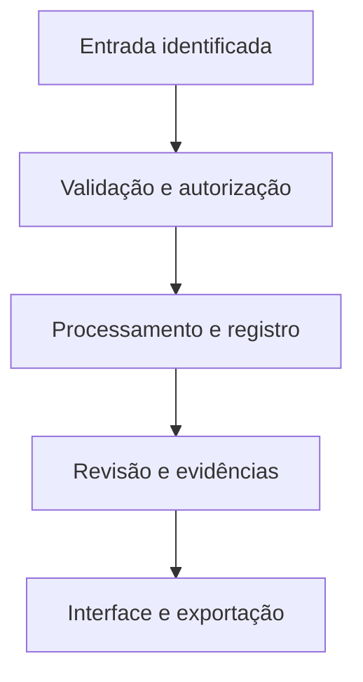

# Arquitetura proposta

## Configurar

Identificar estação, montagem, relógio e canais.

## Adquirir

Ler amostras e contar sequência/perdas.

## Preservar

Gravar no microSD e transmitir sem bloquear.

## Relacionar

Sessões, pontos e amostras rastreáveis.

## Interpretar

Processamento, referências e revisão.

## Dados do domínio

- **Station / Assembly / Firmware** — Componentes, orientação, versões e configuração.
- **AcquisitionSession / SampleBlock** — seq, t_monotonic, UTC de referência, X/Y/Z, unidade e perdas.
- **FileManifest / SyncState** — Checksum, tamanho, original, confirmação e conflito.
- **Campaign / FieldPoint / EnvironmentalSample** — Ponto, matriz, código, data, responsável e encaminhamento.
- **Spectrum / Method / ProcessingStep** — Instrumento externo, arquivo bruto, eixo e histórico das operações.
- **Calibration / TestRun / Evidence** — Referência, condição, aceitação, resultado e limitações.

## Contas e permissões

Sessão no servidor, autorização por papel e propriedade, arquivos privados por escopo e auditoria de mudanças. A interface nunca é a única barreira de acesso.
